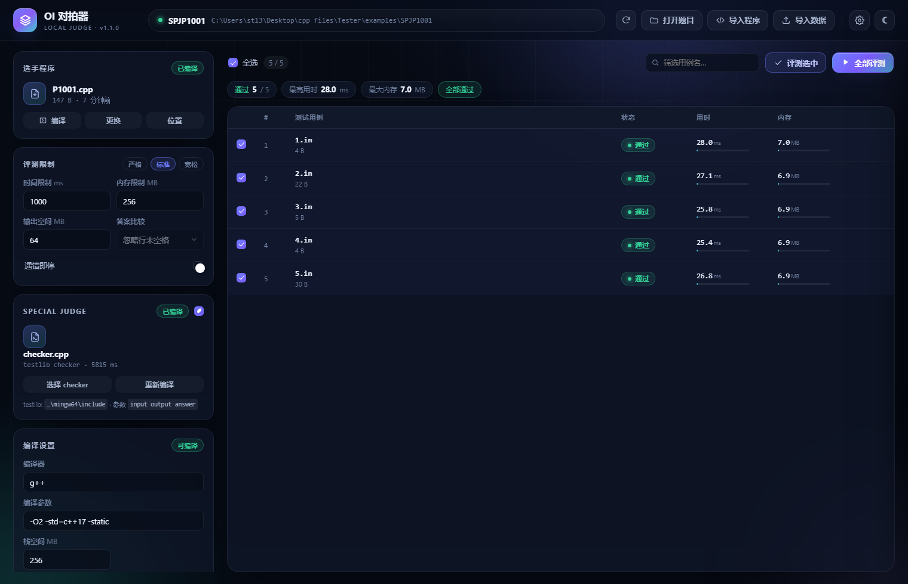
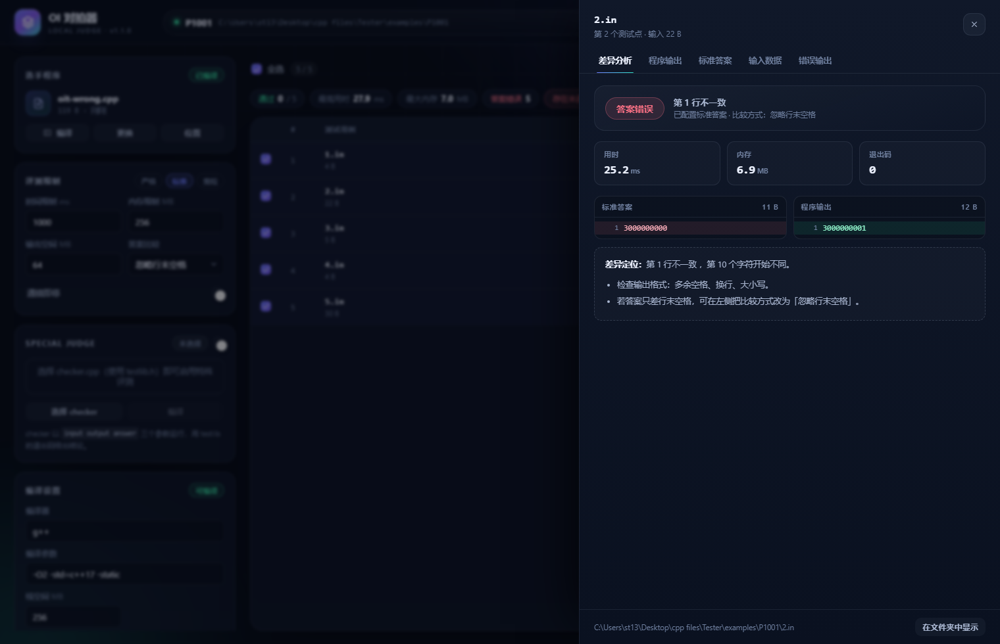
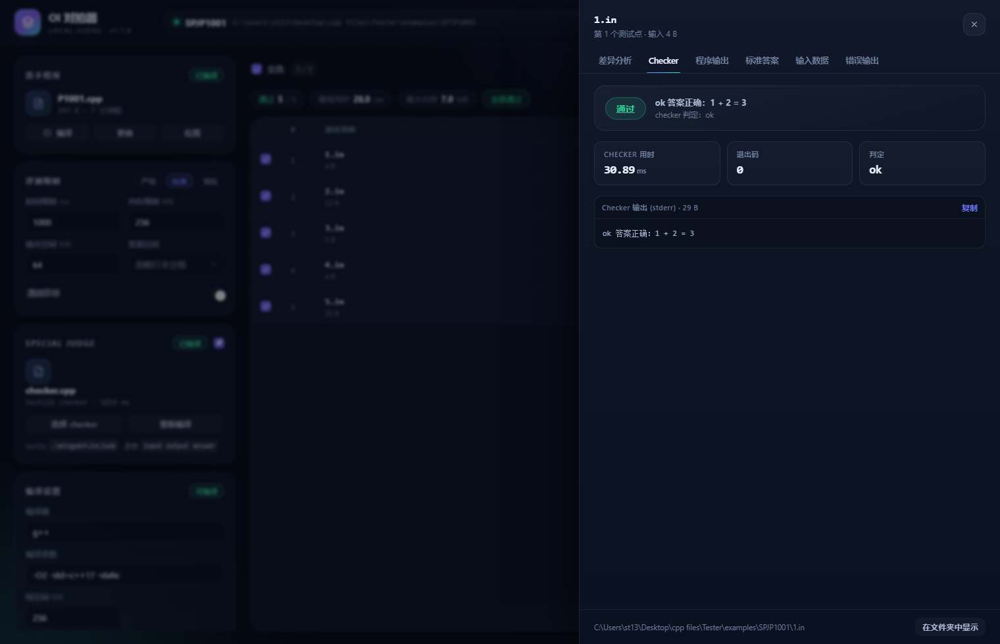

# OI 对拍器

> 面向信息学竞赛选手的本地评测 / 对拍工具：打开题目文件夹即可自动识别数据与程序，一键批量评测，实时给出结果、用时与内存。 



## 目录

- [OI 对拍器](#oi-对拍器)
  - [目录](#目录)
  - [功能一览](#功能一览)
  - [下载与安装](#下载与安装)
    - [环境要求](#环境要求)
    - [启动方式](#启动方式)
    - [在其他电脑上使用](#在其他电脑上使用)
    - [从源码运行](#从源码运行)
  - [使用指南](#使用指南)
    - [题目文件夹约定](#题目文件夹约定)
    - [导入程序与数据](#导入程序与数据)
    - [评测限制与比较方式](#评测限制与比较方式)
    - [Special Judge（testlib）](#special-judgetestlib)
    - [结果与差异分析](#结果与差异分析)
  - [快捷键](#快捷键)
  - [需求对照](#需求对照)
  - [项目结构](#项目结构)
  - [开发与测试](#开发与测试)
  - [发布 Release](#发布-release)
  - [实现细节](#实现细节)
    - [编译](#编译)
    - [精确的限时与限内存](#精确的限时与限内存)
    - [Special Judge](#special-judge)
    - [运行环境](#运行环境)
    - [安全](#安全)
  - [常见问题](#常见问题)
  - [许可证](#许可证)

## 功能一览

- **自动识别**：打开题目文件夹后，自动识别题目名称（文件夹名）、测试数据（`.in` / `.out` / `.ans` 等）与选手程序（`.cpp` / `.cc` / `.cxx` / `.c` / `.py`，或已有的 `.exe`）。
- **灵活导入**：可以随时导入任意源程序；也可以多选 `.in` / `.ans` / `.out` 文件或整个文件夹作为测试数据，自动按文件名配对。
- **自定义限制**：时间、内存、输出空间独立设置；编译参数、栈空间、编译器路径均可修改，并自动记忆。
- **专业评测**：返回 `AC / WA / TLE / MLE / RE / OLE / CE` 等状态，并给出每次运行的用时、峰值内存、退出码与失败原因。
- **按需评测**：勾选任意测试点评测，或全部评测；支持「遇错即停」与随时停止。
- **Special Judge**：支持导入 testlib 风格的 checker（`checker.cpp` / `spj.cpp` 等会自动识别），由 checker 给出通过、答案错误、格式错误与部分分；checker 的判定信息、用时与退出码都能直接查看。
- **差异定位**：逐行对比标准答案与程序输出，标出第一个不一致的位置，并支持三种答案比较模式。
- **顺手好用**：深色 / 浅色主题、快捷键、最近打开的题目、结果汇总条、原生文件选择对话框。





## 下载与安装

到本仓库的 **Releases** 页面下载最新版本：

| 发布包 | 大小 | 适合谁 |
| --- | --- | --- |
| `OI-Tester-<版本>-portable.zip` | 约 15 MB | **推荐**。内置 Python 运行时，解压后双击 `Tester.exe` 即可，不需要安装 Python |
| `OI-Tester-<版本>-lite.zip` | 约 1 MB | 已经装了 Python 3.9+ 的电脑，体积更小 |

两者都是绿色免安装：解压到任意目录，双击 `Tester.exe`（或 `run.bat`）启动；卸载时删掉文件夹即可。

### 环境要求

| 依赖 | 便携版 | 精简版 / 源码 | 说明 |
| --- | --- | --- | --- |
| Windows 10 / 11（x64） | 必需 | 必需 | 使用 Windows Job Object 做精确的内存限制与统计 |
| Python 3.9+ | 已内置 | 必需 | 后端只使用标准库，**无需 pip 安装任何东西** |
| g++ (MinGW-w64) | 可选 | 可选 | 编译 C/C++ 程序时必需；MinGW 自带 `testlib.h`，Special Judge 可直接使用 |
| Microsoft Edge 或 Chrome | 必需 | 必需 | 界面以独立应用窗口打开；没有时回退到系统默认浏览器 |

> 便携包只内置了 Python，**没有内置 g++**。只评测 Python 程序、或直接运行已有 `.exe` 时不需要安装 g++；
> 编译 C/C++ 时请安装 MinGW-w64，并在「编译设置」里填写 `g++` 的路径（或把它加入 `PATH`）。

### 启动方式

1. **双击 `Tester.exe`**（推荐）。启动器会自动寻找 Python（优先使用 `runtime\` 下的便携运行时），在后台启动服务并打开应用窗口。
2. 或者双击 `run.bat`（与 `Tester.exe` 等价）。
3. 或者使用命令行：

   ```bat
   python main.py
   python main.py --open "D:\OI\P1001"
   python main.py --browser
   ```

启动后只会监听 `127.0.0.1` 的随机端口，并使用随机令牌校验请求，**所有数据都留在本机**。

想先看看效果？打开应用后点击「试用示例题目」，会自动载入 `examples/P1001`（5 个测试点）；点击「Special Judge 示例」则会打开自带 checker 的 `examples/SPJP1001`。

### 在其他电脑上使用

- **用便携版**：整个文件夹拷到另一台 Windows 10/11（x64）电脑，双击 `Tester.exe` 即可，不需要安装 Python；编译 C/C++ 仍需那台电脑上有 MinGW-w64 的 `g++`。
- **用精简版**：目标电脑需要 Python 3.9+（安装时勾选 *Add Python to PATH*）。
- 首次运行可能被 SmartScreen 拦截（程序未签名）：点「更多信息 → 仍要运行」。
- 设置、编译缓存与运行产物默认保存在 `%LOCALAPPDATA%\OITester`，不会写进程序目录；想做成 U 盘便携版，可以设置环境变量 `OITESTER_HOME` 指向程序目录下的某个文件夹。

### 从源码运行

```bat
git clone <仓库地址>
cd <仓库目录>
python main.py
```

或者用 MinGW 构建启动器：

```bat
build.bat
```

构建需要 `g++` 与 `windres`（MinGW-w64 自带），产物是 `Tester.exe`。

## 使用指南

### 题目文件夹约定

推荐把一道题放在独立文件夹里，文件名前缀一致即可：

```text
P1001/
├── P1001.cpp          ← 选手程序（优先选择与文件夹同名的 .cpp）
├── 1.in               ← 输入
├── 1.out              ← 标准答案（也支持 .ans / .answer / .expected / .exp）
├── 2.in
├── 2.out
├── data/              ← 也支持子目录，会递归扫描
│   ├── 10.in
│   └── 10.ans
└── input.txt          ← 单测试点写法：input.txt + output.txt
```

识别规则：

- 输入：`.in` `.inp` `.input`；答案：`.out` `.ans` `.answer` `.expected` `.exp` `.ou`，按「同目录 + 同名」配对。
- 没有答案的 `.in` 也可以评测，结果标记为「运行完成」，只统计用时与内存。
- 程序：优先选择与文件夹同名的源文件，其次 `main / solution / sol` 等常见命名；会自动排除 `brute / std / gen / checker` 之类的文件。没有源码时可以直接使用文件夹内的 `.exe`。
- 用例按自然序排序（`2.in` 排在 `10.in` 前面）。

### 导入程序与数据

| 操作 | 说明 |
| --- | --- |
| 打开题目 | 选择一个文件夹，自动扫描题目名、数据与程序 |
| 导入程序 | 选择 `.cpp / .cc / .cxx / .c / .py / .exe`；导入后会清空旧结果 |
| 导入数据 | 可多选文件或直接选文件夹；选中的 `.in` 会自动找同目录同名答案，只选答案文件也能反向匹配 |
| 位置 | 在资源管理器中定位当前源程序 |

数据、路径、设置都会在切换题目后重新识别；「重新扫描」可在文件夹内容变化后刷新。

### 评测限制与比较方式

| 设置 | 含义 |
| --- | --- |
| 时间限制 | 从进程启动到退出的实际运行时间，超过即 `TLE`（含 25ms 调度宽容） |
| 内存限制 | 进程提交内存的上限，通过 Windows Job Object 强制约束，超限即 `MLE` |
| 输出空间 | 标准输出 / 错误输出以及工作目录写入文件的大小上限，超限即 `OLE`（防止死循环输出撑爆磁盘） |
| 栈空间 | 编译时通过 `-Wl,--stack=` 设置的栈大小，适合递归较深的题目 |
| 遇错即停 | 遇到第一个非 `AC` 的测试点就停止，剩余标记为「已跳过」 |

三档快捷预设：**严格**（0.5s / 128 MB / 32 MB）、**标准**（1s / 256 MB / 64 MB）、**宽松**（2s / 512 MB / 128 MB）。所有限制按题目实际要求修改即可，并会自动保存。

答案比较模式：

- **忽略行末空格（推荐）**：忽略每行末尾的空格 / 制表符与文件末尾多余的空行，符合绝大多数 OI 题目的判定习惯。
- **忽略所有空白**：按「单词」比较，换行与空格差异都不影响结果。
- **严格逐字节**：保留行末空格与空行，任何差异都判 `WA`。

### Special Judge（testlib）

有些题目的答案不唯一（构造题、方案题），或者需要忽略特定的格式差异，这时可以让 checker 来判定。

**使用方式**

1. 打开题目文件夹时，如果根目录或一层子目录里有 `checker.cpp`、`spj.cpp`、`chk.cpp`、`judge.cpp` 等命名的源文件，会自动识别并启用 Special Judge。
2. 也可以点击左侧「Special Judge」卡片里的「选择 checker」，选择任意 `.cpp` / `.cc` / `.cxx` / `.c` / `.exe`。
3. 评测时会自动编译 checker（结果会缓存；checker 或编译参数变化后自动重新编译），也可以点「编译 / 重新编译」手动触发。
4. 详情抽屉里会多出「Checker」标签页，显示判定信息、checker 用时与退出码。

选择结果按题目文件夹记忆，下次打开同一道题会沿用；卡片右上角的开关可以随时关闭，关闭后回到普通答案比较。

**checker 的约定**

- checker 以 `checker.exe <input> <output> <answer>` 的形式运行，与 testlib 的 `registerTestlibCmd` 完全一致。
- 本机 MinGW 自带 `testlib.h`，程序会自动在编译器目录中定位并追加 `-I`，无需额外配置；也可以自己用编译参数指定。
- checker 的标准错误（stderr）会作为判定信息展示，例如 `wrong answer 第 1 行应为 3，实际为 4`。
- checker 自身的运行限制：10 秒、1024 MB；checker 超时或崩溃会显示为「Checker 异常」，不会误判成选手的错误。
- 没有 `.ans` 的测试点会用空答案文件运行 checker（不读取答案的 checker 依然可以正常工作）。

**退出码与状态**

| 退出码 | testlib 含义 | 界面状态 |
| --- | --- | --- |
| 0 | `_ok` | 通过 |
| 1 | `_wa` | 答案错误 |
| 2 | `_pe` / `_dirt` | 格式错误 |
| 3 | `_fail` | Checker 异常 |
| 7 | `_points`（`quitp`） | 部分分（分数 ≥ 1.0 记为通过） |
| 其它 | 异常 | Checker 异常 |

checker 返回 `_points` 时会把 `quitp(score, msg)` 里的分数解析出来并标记为「部分分」；`_pc(k)` 形式编码在消息里的部分分也能识别。不用 testlib 也可以写 checker：普通 C++ 程序读取三个参数、按退出码返回即可。

### 结果与差异分析

- 主界面列出每个测试点的状态、用时、内存（附带相对限制的进度条），顶部汇总「通过数 / 最高用时 / 最大内存 / 结论」。
- 点击任意一行打开详情抽屉：
  - **差异分析**：并排显示标准答案与程序输出，首个差异行高亮，给出第几行、第几个字符开始不同，并附常见原因提示。
  - **Checker**（启用 Special Judge 时）：checker 的判定信息、退出码、用时与分数。
  - **程序输出 / 标准答案 / 输入数据 / 错误输出**：分标签查看，可一键复制。
- 鼠标悬停行末的「详情」或直接点击整行都可以打开抽屉；`Esc` 关闭。

## 快捷键

| 快捷键 | 功能 |
| --- | --- |
| `F5` | 全部评测 |
| `Ctrl + Enter` | 评测选中的测试点 |
| `Ctrl + O` | 打开题目文件夹 |
| `Esc` | 关闭抽屉 / 设置面板 |

## 需求对照

| 原始需求 | 实现情况 |
| --- | --- |
| 打开题目文件夹，自动识别题目名称、测试数据与选手程序 | 文件夹名即题目名；递归扫描并配对数据；按命名规则挑选源程序或已有 exe |
| 导入指定文件作为选手程序与测试用例 | 原生文件对话框，支持多选文件 / 文件夹，自动配对 |
| 自定义内存与空间限制 | 时间 / 内存 / 输出空间 / 栈空间均可调，另有编译器与编译参数 |
| 评测结果、内存占用、时间消耗 | 状态胶囊 + 用时（ms）+ 峰值内存（MB）+ 退出码 + 差异定位 |
| 只评测选中用例、全部评测 | 勾选评测 / 全部评测 / 遇错即停 / 随时停止 |
| 界面美观 | 深色 / 浅色双主题、玻璃质感卡片、渐变强调色、状态色系统、动效与细节打磨 |
| （进阶）Special Judge | 自动识别或手动导入 testlib checker，展示 checker 判定、格式错误、部分分与运行信息 |

## 项目结构

```text
Tester/
├── main.py               Python 入口：单实例、启动服务、打开界面
├── app/
│   ├── judge.py          评测内核：编译、Job Object 限时/限内存、答案比对、Special Judge
│   ├── detect.py         题目文件夹识别：数据配对、程序与 checker 挑选
│   ├── session.py        会话状态、编译缓存、评测调度
│   ├── server.py         本地 HTTP 服务与 JSON API
│   ├── dialogs.py        原生文件对话框（后台 Tk 线程）
│   ├── store.py          设置与最近记录持久化
│   └── paths.py          数据目录约定
├── web/                  前端界面（原生 HTML / CSS / JS，无框架、无构建步骤）
│   ├── index.html
│   ├── style.css
│   ├── app.js
│   └── favicon.svg
├── launcher/             C++ 启动器源码与资源（Tester.exe）
├── tools/                开发脚本：make_release.ps1、ui_shot.py、make_icon.py
├── examples/             示例题目（P1001 与带 checker 的 SPJP1001）
├── tests/test_judge.py   单元测试（25 个）
├── assets/               应用图标
├── docs/                 文档截图
├── .github/workflows/    GitHub Actions 自动测试
├── build.bat             构建 Tester.exe
├── run.bat               备用启动脚本
├── LICENSE               MIT 许可证
├── CHANGELOG.md          更新日志
└── RELEASING.md          发布流程说明
```

数据目录（可在设置中查看）：`%LOCALAPPDATA%\OITester`

- `settings.json`：限制、编译设置、主题、最近打开的题目、每道题的 checker 选择
- `build/`：编译缓存（选手程序与 checker 分开缓存）
- `runs/`：每个测试点最近一次的输出，用于差异查看
- `work/`：运行时的临时工作目录（每次评测后自动清理）
- `tmp/`：编译器使用的临时目录（避免受系统 `%TEMP%` 权限影响）
- `browser/`：应用窗口使用的独立浏览器配置
- `logs/tester.log`：后台日志（无控制台时排查问题用）

可用环境变量 `OITESTER_HOME` 把数据目录改到别处（便携使用）。

## 开发与测试

```bat
:: 运行单元测试（25 个用例：编译、AC/WA/TLE/MLE/RE/OLE、识别与配对、Special Judge 与部分分）
python -m unittest tests.test_judge -v

:: 仅自检
python main.py --check

:: 构建启动器（需要 MinGW-w64 的 g++ 与 windres）
build.bat
```

界面是纯静态文件，修改 `web/` 后刷新窗口即可生效；后端改动需要重启程序。

开发辅助脚本：

- `tools/make_release.ps1`：一键生成 GitHub Release 用的便携版 / 精简版压缩包与校验和。
- `tools/ui_shot.py`：通过 Edge 无头模式 + CDP 打开界面、执行 JS 并截图（用于视觉验收）。
- `tools/make_icon.py`：重新生成 `assets/icon.ico`（依赖 Pillow 与 numpy）。

仓库自带 [GitHub Actions](.github/workflows/tests.yml)：在 `windows-latest` 上安装 MinGW 与 Python 后运行全部单元测试。

## 发布 Release

```powershell
powershell -ExecutionPolicy Bypass -File tools\make_release.ps1
```

会在 `dist/` 生成便携版、精简版、`SHA256SUMS.txt` 与 `RELEASE_NOTES.md`，把前三个上传到 GitHub Release 即可。
完整的发版步骤（版本号、tag、`gh release create`）见 [RELEASING.md](RELEASING.md)。

## 实现细节

### 编译

- 使用 `g++ source.cpp -o exe -O2 -std=c++17 -static -Wl,--stack=...`，在源文件所在目录执行，兼容相对路径的 `#include`。
- 编译产物放在数据目录，不污染题目文件夹；源文件或编译参数变化时自动重新编译。
- `-static` 在个别环境不可用时自动降级重试一次。
- Python 程序无需编译，直接用当前解释器运行。

### 精确的限时与限内存

- 用 `CreateProcessW(..., CREATE_SUSPENDED, ...)` 创建进程，先加入 Job Object 再 `ResumeThread`，消除「先跑起来再限制」的竞态。
- Job Object 设置 `JOB_OBJECT_LIMIT_PROCESS_MEMORY` 限制提交内存，`KILL_ON_JOB_CLOSE` 保证评测结束后不残留子进程。
- 通过 `QueryInformationJobObject` 读取 `PeakJobMemoryUsed` 与内核 / 用户态 CPU 时间。
- 关联 IO 完成端口监听 `JOB_OBJECT_MSG_PROCESS_MEMORY_LIMIT`，这样「一次性申请超大内存被系统直接拒绝」也能准确判为 `MLE`，而不会被误判成 `RE`。
- 超时 / 超输出时使用 `TerminateJobObject` 结束整棵进程树。

### Special Judge

- 自动识别命名包含 `checker` / `spj` / `chk` 的源文件，并把它们从选手程序候选中排除。
- 编译 checker 时复用普通编译参数，并自动在编译器目录（`include`、`x86_64-w64-mingw32/include`、`g++ -E -v` 的搜索路径）里定位 `testlib.h` 追加 `-I`。
- checker 编译产物独立缓存，与选手程序互不影响；判题前若 checker 不可用，会把所有选中测试点标为「Checker 异常」，而不是让选手背锅。
- 运行时以 `checker input output answer` 调用，读取 stderr 作为判定信息，按退出码映射 `AC / WA / PE / PC / CJF`；`quitp` 的分数从消息前缀解析，`partially correct (k)` 也会识别。
- checker 有独立的 10 秒 / 1024 MB 限制与临时工作目录，不会影响选手程序的计时与内存统计。

### 运行环境

- 每次评测在临时目录中运行，输入文件会以原名复制进去，`freopen("1.in", "r", stdin)` 之类的写法也能工作。
- 标准输入 / 输出 / 错误分别重定向到文件，便于统计输出体积与查看。
- 若程序把答案写进了文件而标准输出为空，评测器会自动识别唯一产物并参与比较。
- 崩溃退出码会翻译成可读原因，例如 `0xC00000FD` → 栈溢出、`0xC0000005` → 非法内存访问。

### 安全

- HTTP 服务只绑定 `127.0.0.1`，每次启动生成随机令牌；界面与接口请求都校验令牌。
- 界面关闭后（无心跳）服务会自动退出，避免留下后台进程。
- 退出程序时会一并关闭它打开的应用窗口。

## 常见问题

**启动后没有窗口？**
检查是否安装了 Edge / Chrome；也可以先用 `python main.py --browser` 用默认浏览器打开。日志在 `%LOCALAPPDATA%\OITester\logs\tester.log`。

**提示找不到编译器？**
在「编译设置」里把编译器填成完整路径，例如 `D:\mingw64\bin\g++.exe`；或把 MinGW 的 `bin` 加入 `PATH`。

**内存显示比预期大（例如 7 MB）？**
统计的是进程峰值提交内存，包含 C/C++ 运行时、静态链接库与已提交的栈页，属于正常开销；题目内存限制通常也按这个口径判定。

**为什么 `freopen` 到别的文件名读不到数据？**
评测器会把当前测试点的输入文件按原名复制到工作目录，并同时重定向标准输入。若程序写死了 `problem.in` 之类的其它名字，请改成标准输入，或在文件夹内提供同名文件。

**大数据评测很慢？**
默认串行评测以保证计时稳定；可以只勾选需要复测的点。关闭「自动编译」可以复用上次的编译产物。

**checker 编译很慢 / 找不到 testlib.h？**
testlib.h 是一个很大的单头文件，首次编译约需数秒，之后会走缓存。若提示找不到 `testlib.h`，可在「编译设置 → 编译参数」里追加 `-I"你的 MinGW\mingw64\include"`，或确认 MinGW 安装完整。

**checker 判定和普通答案比较有什么区别？**
启用 Special Judge 后，答案比较方式不再生效，一切以 checker 的退出码与消息为准；关闭开关即可回到普通比较。

**checker 能不能返回部分分？**
可以。testlib 的 `quitp(score, msg)` 会解析出分数并显示为「部分分」；`_pc(k)` 写法也支持。

**没有标准答案的测试点能用 checker 吗？**
可以。评测器会传入一个空的答案文件，不读取答案的 checker 能正常工作；读取答案的 checker 会得到 EOF（通常判为格式错误）。

**换一台电脑需要重新配置吗？**
不需要。用便携版解压即用；设置、最近打开的题目与每题的 checker 选择保存在 `%LOCALAPPDATA%\OITester`，不会跟着程序目录走。想整套带走，可以设置 `OITESTER_HOME` 指向便携目录。

**会不会改坏我的题目文件夹？**
不会。编译产物、运行目录与结果都放在独立的数据目录，只有「在文件夹中显示」会打开资源管理器。

## 许可证

本项目使用 [MIT License](LICENSE)。

便携版内置的 Python 运行时使用 PSF 许可证（见 `runtime/PYTHON-LICENSE.txt`），Tcl/Tk 的许可证在 `runtime/tcl/` 中。

---

使用中有任何建议，欢迎直接修改 `web/` 与 `app/` 下的代码——前后端都是普通脚本，没有构建步骤，也没有第三方依赖。 
